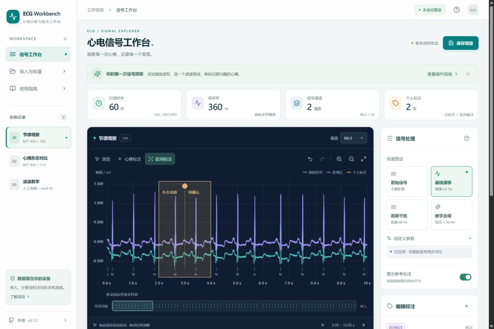
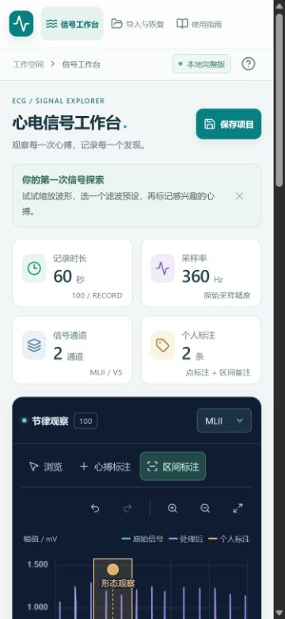

# v0.1.2 界面检查与视觉迭代

日期：2026-10-31。检查现有 ECG Workbench 后完成界面优化，保留“浅色工作区＋深色波形”、中文工具界面及现有分析／标注范围。

## 检查发现与处理

| 发现 | 本轮调整 |
|---|---|
| 辅助文字常为 7—10 px，颜色偏浅 | 正文和表单主要为 12—14 px，辅助信息主要为 10—12 px，增强文字及坐标对比；保留波形原始／处理后颜色。 |
| 标题、新手提示和指标分散注意力 | 标题明确为“心电信号工作台”，提示更紧凑，统一卡片间距、边界和圆角。 |
| 手机侧栏压缩波形，工具按钮拥挤 | 改为顶部导航；标注模式和撤销／缩放分行展示，主要按钮文字保留，侧边设置改为单列。 |
| 低高度桌面侧栏出现额外滚动 | 在低于 800 px 的桌面高度隐藏补充说明卡，保留导航、示例与项目入口。 |
| 平板相邻点与区间标签相互遮挡 | 图中文字最多排为三行，优先选中标注，超长标签省略且提供完整标题；密集时隐藏部分文字但保留所有位置标记。手机优先显示选中标注的文字。 |
| 外部字体依赖及局部焦点不明显 | 移除 Google Fonts 加载，使用本机中文／系统字体；统一焦点描边，文件选择区域有 focus-within，遵循减少动态效果偏好。 |

样式迭代集中在 `src/visual.css`，由 `main.tsx` 在原基础样式后加载。波形容器高度由 ResizeObserver 同步给 uPlot；标注标签布局位于 `geometry.ts`，不修改任何采样索引。PNG 导出仍保留完整标注文字和原始位置，手机上的文字精简仅影响界面显示。

## 本轮实际验证

- 前端 **35 项通过**：原有 33 项，以及相邻标注标签不重叠／索引不变、选中标注和长标签边界的两项回归。
- Python **24 项通过**；本机真实 HTTP **10 项通过**；TypeScript 与 Vite 生产构建通过。Python 仍有第三方弃用警告，未作为界面任务扩大依赖升级范围。
- 新源码包的独立解压副本重新执行 `npm ci`、35 项前端测试、24 项 Python 测试与生产构建，均通过；该副本 Python 使用本项目已有锁定环境，不宣称重新创建了 Python 环境。源码包 CRC 和逐文件 SHA-256 校验通过。
- 应用内浏览器检查 **320×800、375×812、768×1024、1280×720、1440×960**：页面无横向溢出。标注表格在窄屏保留内部横向滚动，避免压缩采样位置与备注。1280×720 下侧栏无额外滚动。
- 实际添加 3 秒心搏点、拖选 2—4 秒区间，输入中文标签与备注，选择高通 0.5 Hz，查看同步处理曲线；检查自定义参数、标注表格和选中详情。
- 实际查看手机帮助弹窗与生产版导入对话框，确认文字、控件和关闭入口显示正常。
- 实际导出 **1666×884 RGBA PNG** 并查看：坐标、采样率、单位、处理参数、两条曲线、区间／心搏标签及参考符号显示正常。
- 另开独立本机生产页面，示例、滤波和导入对话框显示正常，该生产标签页收集到的错误／警告日志为空。开发预览曾有首次依赖缓存更新时的历史 React 错误，未用该历史日志声称整段开发过程无错误。

本轮没有更改 DSP 算法和项目包版本，也未新增 AI 分类、临床判断或业务功能。此前的数值对照、完整 WFDB 与项目恢复结果参见 [v0.1.1 验收](v0.1.1验收记录.md)，不冒充本轮重新执行。

## 界面证据

下图均为实际浏览器截图，数据来自公开 MIT-BIH 示例，标注仅用于 UI 测试。

改版前截图、其他断点、标注编辑区与下载 PNG 保存在本机 `artifacts/ui-review-2026-10-31/`；此目录不作为源码提交。截图尺寸是所设浏览器视口，系统滚动条会占用部分可用宽度。

## 发布与范围

通过现有 GitHub Pages 工作流更新在线界面，保留已有 v0.1.0 和 v0.1.1 发布。新源码包仍排除缓存、依赖、私有数据和凭据，并核对 CRC／SHA-256；远端 CI 和部署结果以本次提交对应的 Actions 为准。

此记录不是完整 WCAG 合规认证；独立 Chrome／Edge、实际手机触屏和慢网冷启动未单独验证。
